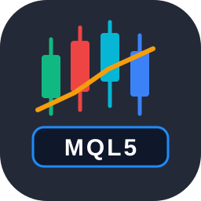
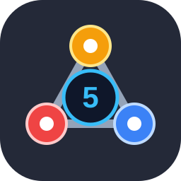
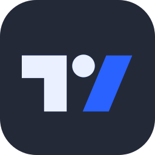
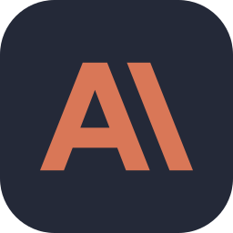
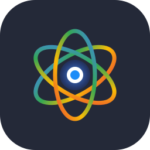
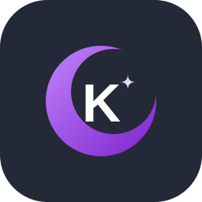

<!-- ========================================================================================== -->
<!--                                   HEADER & BANNER                                         -->
<!-- ========================================================================================== -->

  

# ⚡ YAO Christ Yvan

### `Backend Developer` &nbsp;•&nbsp; `Quantitative Trading` &nbsp;•&nbsp; `AI Systems`

  🎓 <b>Licence 1 MIAGE — Université Félix Houphouët-Boigny</b> &nbsp;|&nbsp; 📍 <b>Abidjan, Côte d'Ivoire</b>

---

<!-- ========================================================================================== -->
<!--                                   PROFIL & EXPERTISE                                       -->
<!-- ========================================================================================== -->

  Étudiant en <b>MIAGE</b> à l'Université Félix Houphouët-Boigny, je combine la rigueur analytique des mathématiques financières et l'ingénierie logicielle moderne pour concevoir des architectures logicielles résilientes, des agents autonomes et des modèles de trading algorithmiques.

<table>
  <tr>
    <td width="50%" valign="top">
      <h4 align="center">🤖 Intelligence Artificielle & Backend</h4>
      
Architectures logicielles & agents autonomes

      <ul>
        <li><b>Ingénierie Backend :</b> Développement d'APIs performantes et modulaires en Python (Django, FastAPI).</li>
        <li><b>Workflows Intelligents :</b> Intégration d'agents autonomes et automatisation avancée (Agent OS, Claude Code CLI).</li>
        <li><b>Rigueur Logicielle :</b> Traçabilité, code propre et pipelines de données résilients.</li>
      </ul>
    </td>
    <td width="50%" valign="top">
      <h4 align="center">📈 Finance Quantitative & Trading</h4>
      
Trading algorithmique & analyse institutionnelle

      <ul>
        <li><b>Trading Algorithmique :</b> Développement et déploiement d'Expert Advisors en <b>MQL5</b> sur <b>MetaTrader 5</b>.</li>
        <li><b>Structures de Marché :</b> Exploitation des flux institutionnels (Smart Money Concepts / ICT, Order Blocks, FVG).</li>
        <li><b>Recherche Quantitative :</b> Backtests sans biais de lookahead et analyse statistique des dynamiques de prix.</li>
      </ul>
    </td>
  </tr>
</table>

  <i>« L'alliance entre la rigueur mathématique des flux de marché et l'élégance d'une ingénierie logicielle durable. »</i>

---

<!-- ========================================================================================== -->
<!--                                      TECH STACK                                            -->
<!-- ========================================================================================== -->
### 💻 Tech Stack & Écosystème

#### 🚀 Langages & Backend Web
<!-- Stack de référence pour le backend, les bases de données et les environnements système -->

  

#### 📈 Finance Quantitative & Trading Algorithmique
<!-- Analyse technique institutionnelle (SMC/ICT), automates MQL5 & charting professionnel -->

  
  &nbsp;&nbsp;&nbsp;
  
  &nbsp;&nbsp;&nbsp;
  

  
  &nbsp;
  
  &nbsp;
  

#### 🤖 Assistants IA
<!-- Outils d'ingénierie assistée par IA et agents d'automatisation utilisés au quotidien -->

  
  &nbsp;&nbsp;&nbsp;
  
  &nbsp;&nbsp;&nbsp;
  
  &nbsp;&nbsp;&nbsp;
  

  
  &nbsp;
  
  &nbsp;
  
  &nbsp;
  

---

<!-- ========================================================================================== -->
<!--                                   GITHUB ANALYTICS                                         -->
<!-- ========================================================================================== -->
### 📊 GitHub Analytics

  
  

  

---

<!-- ========================================================================================== -->
<!--                               HACKATHONS & DISTINCTIONS                                    -->
<!-- ========================================================================================== -->
### 🏆 Hackathons & Distinctions

- 🥇 **1ère Place — Hackathon MIAGE (Université Félix Houphouët-Boigny)** : Projet *Smart Presence QR* (solution de pointage dynamique par QR code sécurisé pour amphithéâtres).
- 🏅 **4e Prix — VIBEATHON Côte d'Ivoire 2026** : Équipe *VORTEXON*, Projet *EcoLoop CI* (plateforme citoyenne de traçabilité et valorisation intelligente des déchets plastiques).
- ⚡ **Technovor Hackathon 2026 (ESATIC)** : Participation intensive au marathon de prototypage de solutions technologiques sous contrainte de temps.
- 🎓 **Bourse d'Excellence DataCamp Donates × iSHEERO** : Parcours certifiant en Machine Learning, Deep Learning (PyTorch) et Data Science appliquée.

---

<!-- ========================================================================================== -->
<!--                                   PROJETS PHARES                                           -->
<!-- ========================================================================================== -->
### 🚀 Projets Phares

| Projet | Description | Technologies Clés |
| :--- | :--- | :--- |
| [**EcoLoop CI**](https://github.com/Christ-yavn/ecocycle-ci) | Plateforme citoyenne de collecte, traçabilité et valorisation des déchets en Côte d'Ivoire (Primé VIBEATHON). | Django, Python, React, Tailwind, Supabase |
| [**Quant Pod**](https://github.com/Christ-yavn/quant-pod) | Moteurs scientifiques en Python pur (`numpy`/`scipy`) pour la recherche quantitative et les backtests sans biais. | Python 3.12, NumPy, SciPy, Claude Code |
| [**YouTube Video Extractor**](https://github.com/Christ-yavn/youtube-video-extractor) | Compilateur universel de vidéos éducatives en cours structurés, manuels formels et datasets `.jsonl` (v4.0). | React 19, TypeScript, Python CLI, Claude API |
| [**Bot Quant MQL5**](https://github.com/Christ-yavn/bot-quant-) | Bots de trading algorithmique Forex (Order Blocks / FVG - SMC) et indices synthétiques (Crash & Boom). | MQL5, MetaTrader 5, Python |

---

<!-- ========================================================================================== -->
<!--                                        QUOTE                                               -->
<!-- ========================================================================================== -->
### 💡 Philosophie de Développeur & Trader Quantitatif

  

  ⚡ Développé avec passion par <b>YAO Christ Yvan</b> • Étudiant en Licence 1 MIAGE à l'UFHB Abidjan

